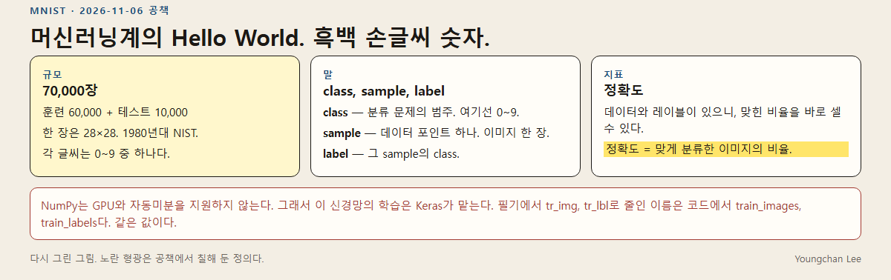
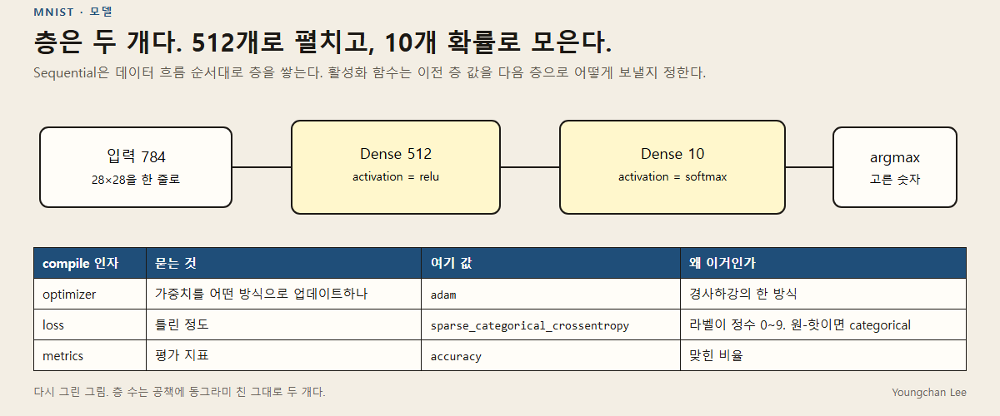
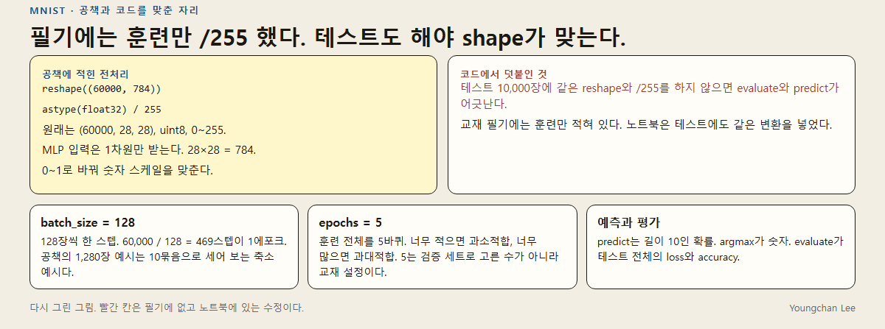
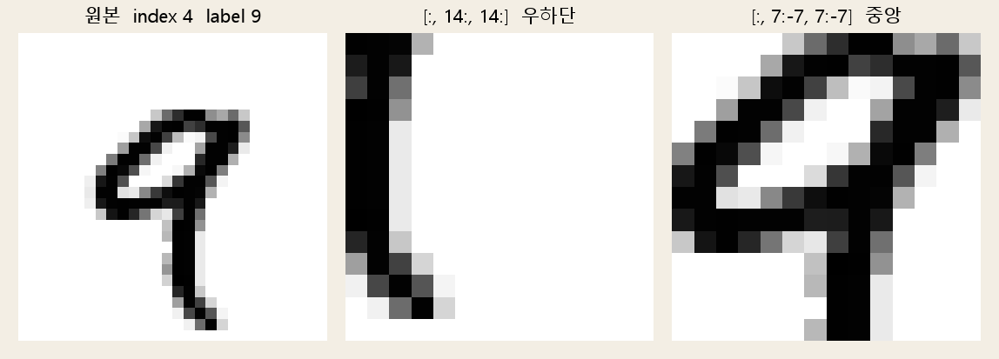
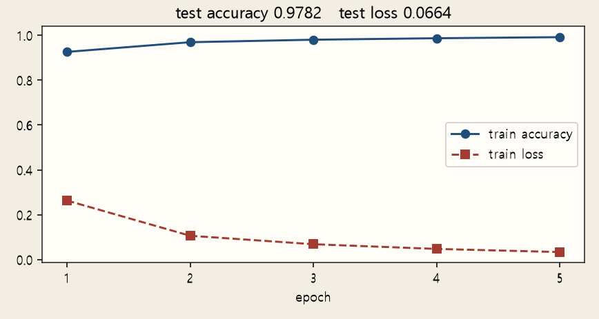
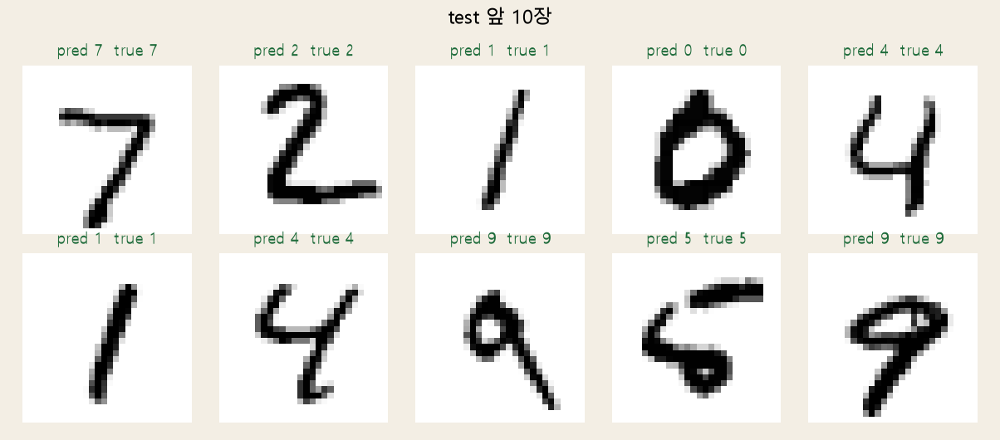
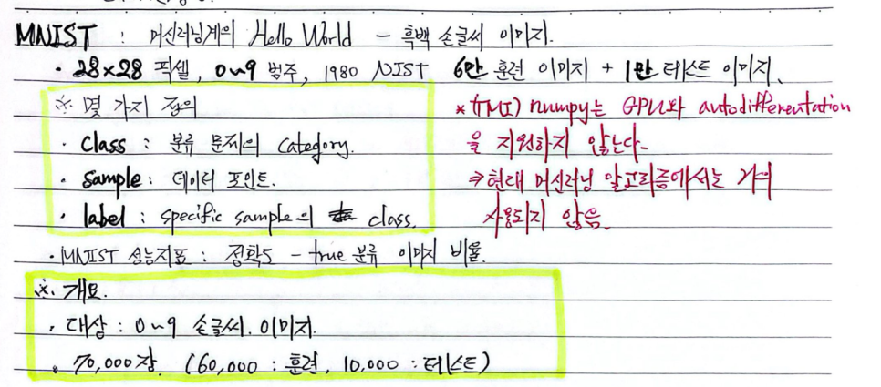
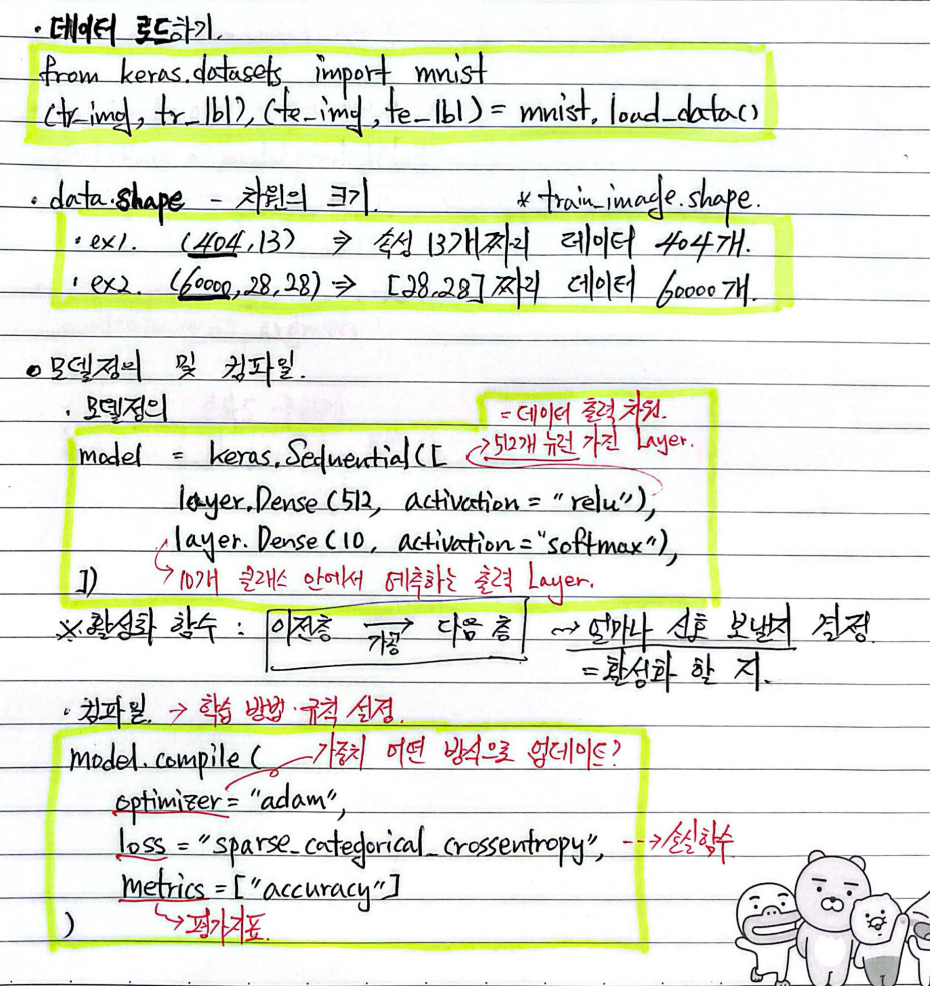
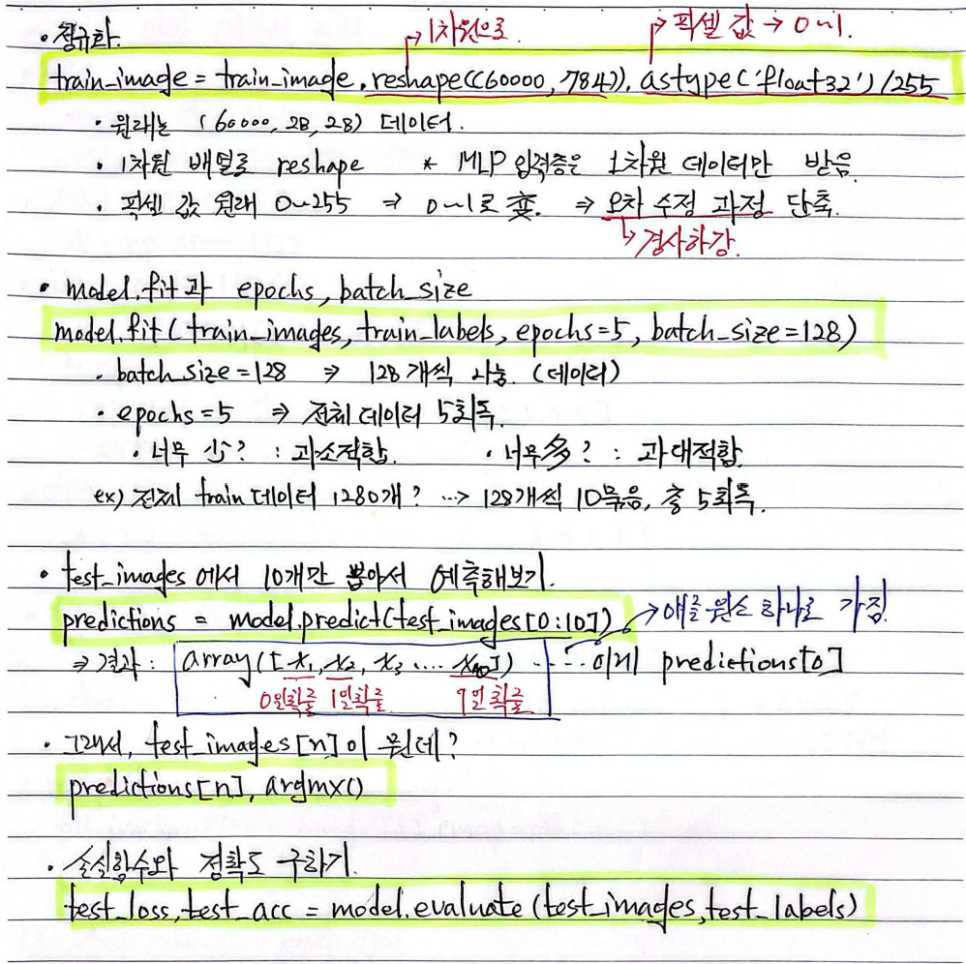

# MNIST, Dense 두 층

흑백 손글씨 숫자를 두 개의 Dense 층으로 분류한 기록이다. 머신러닝 쪽 Hello World로 잡았고, 지표는 정확도다.

필기에서는 `tr_img`, `tr_lbl`로 줄였다. 코드의 `train_images`, `train_labels`와 같은 값이다. 교재 본문은 올리지 않았다. 공책, 그 공책을 코드로 옮기며 고친 자리, 다시 그린 그림, 그리고 2026-11-10에 같은 모델로 이 PC에서 다시 학습한 숫자가 있다.

작성: Youngchan Lee · [일기맨](https://blog.naver.com/caramel2516) · 블로그 글 [MNIST](https://blog.naver.com/caramel2516/224467638068) (2026-11-06)

앞에서 본 기본기: [AI 기본기](https://github.com/JimProKing/ai-basics-notes) · 다음 실습: [Whisper](https://github.com/JimProKing/whisper-local-notes)

## 데이터



- 28×28, 0~9, 1980년대 NIST에서 온 흑백 손글씨
- 훈련 60,000장 + 테스트 10,000장
- class는 범주, sample은 이미지 한 장, label은 그 장의 class
- 정확도는 맞게 분류한 비율
- NumPy는 GPU와 자동미분을 하지 않는다. 학습은 Keras가 맡는다

## 모델



`Sequential`로 층을 두 개 쌓는다.

| 인자 | 여기 값 | 이유 |
| --- | --- | --- |
| optimizer | `adam` | 가중치를 어떻게 업데이트할지 |
| loss | `sparse_categorical_crossentropy` | 라벨이 정수 0~9. 원-핫이면 `categorical_crossentropy` |
| metrics | `accuracy` | 맞힌 비율 |

2026-11-10, 시드 0으로 다시 만들면 파라미터는 407,050개다. 첫 Dense가 401,920, 출력 Dense가 5,130이다.

## 공책과 코드가 다른 자리



원본은 `(60000, 28, 28)`, `uint8`, 0~255다. MLP 입력은 1차원이라 `reshape((60000, 784))`를 하고, `float32`로 바꾼 뒤 255로 나눠 0~1로 맞춘다.

공책에는 훈련 이미지만 그렇게 적혀 있다. 테스트에 같은 변환을 하지 않으면 `evaluate`와 `predict`의 shape가 어긋난다. [MNIST.ipynb](MNIST.ipynb)는 테스트 10,000장에도 같은 `reshape`와 `/255`를 넣는다.

`batch_size=128`이면 60,000 / 128 = 469스텝이 1에포크다. 공책의 1,280장 이야기는 10묶음으로 세어 보는 축소 예시고, 실제 훈련은 6만 장이다. `epochs=5`는 검증 세트로 고른 수가 아니라 교재에 있던 설정이다. 너무 적으면 과소적합, 너무 많으면 과대적합이라고만 적어 두었다.

`predict`는 샘플마다 길이 10인 확률을 내고, `argmax`가 모델이 고른 숫자다. `evaluate`가 테스트 전체의 loss와 accuracy다.

## 공책에 나온 4번 이미지를 실제로 자른 것

훈련 인덱스 4의 라벨은 9다. `[:, 14:, 14:]`는 우하단, `[:, 7:-7, 7:-7]`는 중앙이다.



## 2026-11-10, 이 PC에서 다시 학습

노트북 파일에는 실행 결과가 저장되어 있지 않다. 아래는 같은 구조, 시드 0, CPU로 다시 돌린 결과다. 훈련 22.97초, 평가 0.75초.

| 에포크 | 훈련 loss | 훈련 accuracy |
| --- | --- | --- |
| 1 | 0.2635 | 0.9261 |
| 2 | 0.1063 | 0.9693 |
| 3 | 0.0686 | 0.9804 |
| 4 | 0.0477 | 0.9870 |
| 5 | 0.0337 | 0.9918 |

테스트 loss 0.0664, 테스트 accuracy **0.9782**. 에포크를 늘리거나 층을 바꿔 이 숫자를 더 올리려고 테스트 세트를 들여다보지는 않았다.



테스트 앞 10장의 예측은 정답과 모두 같았다. 7, 2, 1, 0, 4, 1, 4, 9, 5, 9. 앞 10장이 다 맞은 것과, 전체 정확도 97.82%는 다른 이야기다.



원문 숫자는 [results/2026-11-10-cpu.md](results/2026-11-10-cpu.md).

## 실행

```text
pip install -r requirements.txt
```

그다음 [MNIST.ipynb](MNIST.ipynb)를 위에서부터 실행하면 된다. 데이터는 `keras.datasets.mnist`가 받는다.

## 공책 원본

정의, class / sample / label, 정확도.



`load_data`, shape, Dense 512와 Dense 10, `compile`.



전처리, `fit`, `argmax`, `evaluate`. 1,280장으로 스텝을 세는 예가 여기 있다.


